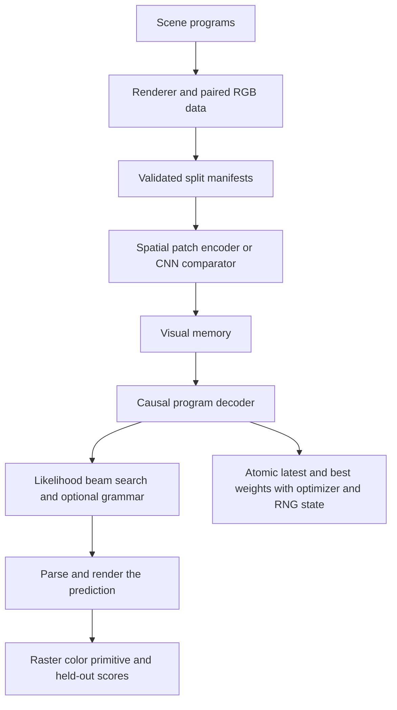

# Pixel to Program

```text
SCENE RECT RED 2 3 10 8 ELLIPSE BLUE 15 12 12 10 END
```


The image above is the renderer's ground truth, not a model prediction. The learning task goes in the other direction: read the 32x32 image, produce a program, execute it, and compare the reconstructed scene. A legal output can still draw the wrong shapes, which is why parsing and reconstruction have separate scores.

## Make a small dataset first

```bash
python -m pip install -e .
python -m pixel_to_program demo --output artifacts/demo.json
python -m pixel_to_program dataset --directory data/generated --train 256 --dev 64 --test 64
python -m pixel_to_program evaluate --output artifacts/codec-check.json
```

These commands use only Python 3.11+ and the standard library. `demo` writes SVG, binary PPM, and a known program. The default `evaluate` checks 36 codec/renderer roundtrips and a blank baseline. It explicitly marks learned-model evaluation false.

The language has rectangles and ellipses in red, blue, or green, bounded integer coordinates, and at most four shapes. Later shapes cover earlier ones. Input images use the project's strict 32x32 binary PPM format; arbitrary SVG input is not accepted.

Training sees red/blue rectangles and red/green ellipses. Development introduces green rectangles; test introduces blue ellipses. A designated held-out primitive must remain visibly responsible for at least half its foreground. Global raster/program hashes prevent split duplicates, and manifest loading verifies the image against its program. This controls one compositional question, not natural-image recognition.

## Train, stop, resume, and search

```bash
python -m pip install -e '.[train]'
python -m pixel_to_program train-system --data-dir data/generated --checkpoint artifacts/attention.pt --epochs 10
python -m pixel_to_program evaluate-system --data-dir data/generated --checkpoint artifacts/attention.pt --beam-size 4
python -m pixel_to_program predict-system --checkpoint artifacts/attention.pt --image artifacts/demo/scene.ppm --beam-size 4
```

`train-system` uses spatial patches, learned row/column positions, a visual Transformer encoder, and a causal program decoder with cross attention. `--architecture cnn_gru` selects the comparator under the same optimizer, data order, loss, and search interfaces. The two models are not parameter matched, and their regularization differs.



Training uses AdamW, clipping, warmup/cosine scheduling, optional label smoothing, and token-weighted development NLL. Latest resume state and best-development inference weights share one atomic checkpoint. Resume restores optimizer/schedule progress, Python/Torch RNG, and dataset/configuration identity. An executed CPU regression compares uninterrupted and resumed weights with dropout enabled; GPU determinism is not claimed.

Inference encodes the image once, batches beam prefixes, and keeps original model likelihood after grammar filtering. Completed hypotheses are archived. Width one remains actual greedy decoding. Grammar masks track field types, shape count, geometry bounds, and EOS placement; they do not establish that a scene matches the input.

## Read the incorrect generations too

The [paired short run](gallery/attention-ablation.json) used 16 training, four development, and four test scenes, with two seeds and two epochs per architecture. Both models produced 8/8 grammar-valid constrained greedy outputs, but **0/8 exact raster matches**. The denominator counts four scenes across two seeds, not eight distinct scenes. Transformer development NLL was worse in that run. [The recorded experiment](reference/spatial-attention-results.md) gives parameter counts and the full ablation conditions.

Use validity, exact raster match, foreground IoU, RGB error, and primitive extraction together. Wrong colors can leave foreground IoU unchanged. Invalid predictions keep their raw token IDs and errors; the code never replaces them with ground-truth programs. The legacy `train`/`evaluate-model` commands remain available for the original CNN/GRU baseline.

## Finding the implementation

- `src/pixel_to_program/scene.py` and `data.py`: scene language, rendering, visibility and split validation.
- `src/pixel_to_program/attention_model.py`, `attention_training.py`, and `attention_inference.py`: neural path and resumable optimization.
- `src/pixel_to_program/search.py`: likelihood search and completion handling.
- `gallery/`: source scene and recorded outputs.
- `reference/attention-and-search.md`: equations, state, complexity, and checkpoint behavior.
- `tools/probe_rendering_contract.py`: selected regressions checked in temporary copies.

Run `RUN_ML_SMOKE=1 PYTHONPATH=src python -m unittest discover -s tests -v` with Torch installed. `python tools/check_vision.py --require-lint --wheel` checks packaging as well. [Rendering defects](reference/rendering-defects.md), [training notes](reference/training-runs.md), and [the check history](reference/check-history.md) document the evidence. No pretrained VLM or useful held-out reconstruction score is supplied.
