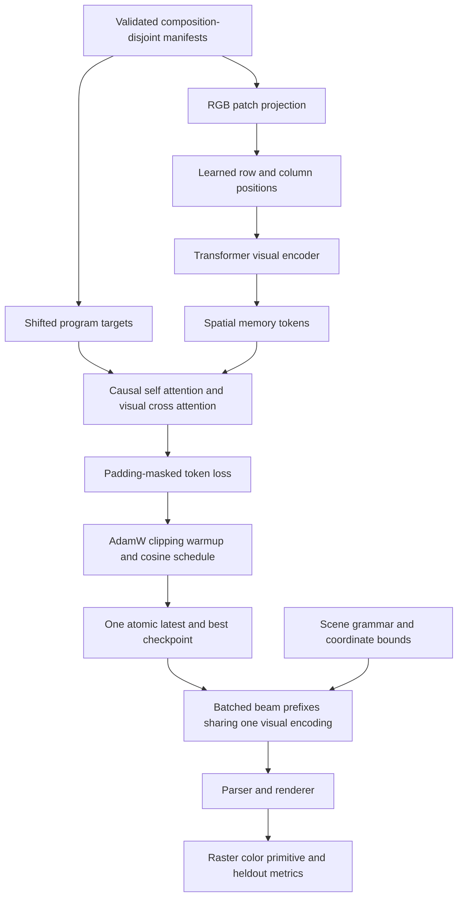

# Spatial attention and executable program synthesis

The implemented system learns a mapping from fixed-size images to programs, executes those programs, and measures the reconstructed scene. It includes a patch-attention model, a CNN/GRU comparator, a shared optimization engine, bounded likelihood beam search, and restartable checkpoints.

## Component boundaries



The public API is [transformer.py](../src/pixel_to_program/transformer.py). Responsibilities are separated into [attention_model.py](../src/pixel_to_program/attention_model.py), [attention_training.py](../src/pixel_to_program/attention_training.py), [attention_inference.py](../src/pixel_to_program/attention_inference.py), [search.py](../src/pixel_to_program/search.py), and [experiments.py](../src/pixel_to_program/experiments.py). Imports remain usable without Torch; execution of neural methods requires the optional training extra.

## Model

A strided convolution projects nonoverlapping RGB patches into `d_model` dimensions. With a 32x32 image and 4x4 patches, the encoder receives 64 spatial tokens. Separate learned row and column embeddings preserve absolute layout. A pre-normalized Transformer encoder mixes those tokens.

The program decoder combines causal self attention over previous program tokens with cross attention to the visual memory:

```text
M = VisualEncoder(PatchProjection(image) + RowPosition + ColumnPosition)
H_t = ProgramDecoder(TokenEmbedding(y_<t) + TokenPosition, M, causal_mask)
p(y_t | image, y_<t) = softmax(TiedVocabularyProjection(H_t))
```

The input embedding and output projection share weights. Token embeddings are scaled by the square root of model width. Embedding initialization accounts for that scale, and cloned attention layers are initialized independently. The CNN/GRU comparator retains the original image-to-global-state architecture; the shared experiment engine uses the same optimizer, schedule, token objective, data order, and search interfaces for both architectures.

The architecture comparison is not parameter matched. Transformer dropout also differs from the legacy GRU's regularization. Reports expose both differences, so the small example experiment cannot establish a causal architectural advantage.

## Training objective and leakage boundary

Programs are encoded as `BOS, program tokens, EOS`. The model input omits the final token and the target omits BOS. The decoder's upper-triangular attention mask prevents a position from reading its future target. Padding is excluded from the loss denominator:

```text
loss = sum(non_padding_target_negative_log_probabilities) / target_token_count
```

Optional label smoothing applies only during training. Development NLL uses unsmoothed, token-weighted cross entropy and selects the best weights. No test score participates in checkpoint selection. Per-case autoregressive generation, not teacher-forced output, supplies test metrics.

The visual gradient test checks that the image branch affects logits and receives gradients. Causal-prefix tests change future tokens and verify that earlier logits remain unchanged. These prove software properties; they do not prove useful visual understanding.

## Search semantics

One image encoding is reused for every beam and decoder step. Active equal-length prefixes are scored in a batch. The decoder currently recomputes prefix attention; it does not claim an incremental decoder KV cache.

The callback returns normalized full-vocabulary log probabilities. Grammar constraints filter candidates **after** normalization, preserving original model joint likelihood rather than silently changing the scoring distribution. A length penalty is explicit:

```text
score(sequence) = sum(token_log_probability) / ((5 + token_count) / 6)^alpha
```

`alpha=0` ranks original likelihood. Nonzero penalties are heuristics and do not produce probabilities. EOS participates in the score. Finished hypotheses are never expanded. A bounded archive retains completions that actually entered the beam, so later unfinished prefixes cannot erase a previously found complete sequence. Width one preserves greedy behavior; pruned EOS alternatives are not secretly added to its archive.

At the token limit, the search selects its best archived completion or exposes an unfinished prefix. It never appends an invented EOS or substitutes the target program. Beam search is approximate unless its width retains every relevant prefix; exhaustive small-language tests check the implementation where that condition holds.

The executable grammar tracks `SCENE`, primitive fields, colors, canvas bounds, shape count, `END`, and EOS. It knows the allowed language, not which scene is correct for the image. Empty scenes can be grammatical while having zero primitive recall.

## Checkpoint state machine

An epoch boundary writes one self-contained checkpoint containing:

- Latest model and optimizer state, epoch, global update count, and full loss history.
- Best-development model weights, selected epoch/update, and selected NLL.
- Python shuffle RNG, Torch CPU RNG, and CUDA RNG when CUDA is explicitly used.
- Architecture/vocabulary, optimizer/schedule plan, split membership, and dataset/configuration fingerprints.

Latest and best weights are stored in the **same atomic snapshot**. Maintaining separate latest and best files would create a crash gap between their updates. Tensor snapshots for best weights are cloned and cannot drift with later updates.

The writer flushes and fsyncs a temporary file, replaces the destination, and fsyncs the directory where supported. Loading uses `weights_only=True`, bounded artifact size, strict schema/configuration checks, strict parameter shapes, and finite weights. Hashes identify artifacts and accidental drift; they are not signatures authenticating an untrusted publisher.

Resume selects latest model/optimizer state and restores RNG after model construction. Prediction and evaluation select embedded best-development weights. Dataset, optimizer plan, architecture, split membership, and planned total steps must match for resume. A stop after one epoch of a two-epoch plan is therefore resumable; changing the plan is a new experiment.

The CPU regression runs an uninterrupted and interrupted/resumed two-epoch training job with dropout, and compares histories and all parameter tensors exactly. GPU RNG is recorded, but GPU kernel determinism and GPU execution were not verified. Checkpoint paths assume a single training writer; no distributed optimizer or multi-writer lease is implemented.

## Evaluation and experiment design

The dataset holds out shape/color compositions while preserving individual factors. Programs/images are globally deduplicated and checked against the renderer. The dataset contains one to three shapes; the language supports four, but no four-object extrapolation claim is made.

Report syntax/EOS validity, exact raster match, foreground IoU, RGB MAE, primitive precision/recall/F1, and heldout-composition recall. Primitive comparison uses multisets because equivalent programs can reorder nonoccluding primitives. Exact raster comparison handles some rendering equivalences; raw background agreement is not a headline score.

`ablation` runs paired seeds over architectures, greedy/beam widths, and raw/grammar-constrained decoding, retaining raw outputs. It uses the same manifest and optimizer-update budget and reports unmatched parameters/regularization. No confidence claim is inferred from two short runs. Failures remain in denominators.

## Complexity and bounds

Let `P` be visual patches, `T` program length, `d` model width, and `K` beam width. Visual self attention costs roughly `O(P^2 d + P d^2)` per encoder layer. Each decoder prefix includes `O(t^2 d + t P d + t d^2)` attention/projection work. Recomputing prefixes over all steps produces approximately `O(K T^3 d + K T^2 P d + K T^2 d^2)` decoder work per layer. Sharing visual memory removes repeated encoder calls, not the decoder's cross-attention projections.

The supported canvas is 32x32, patches are 4/8/16 pixels, generation is at most 32 tokens, and beam width is at most 16. Training dimensions, optimizer steps, input sizes, and checkpoint sizes have explicit bounds. These are controlled experiments, not a natural-image foundation model or a production serving system.
