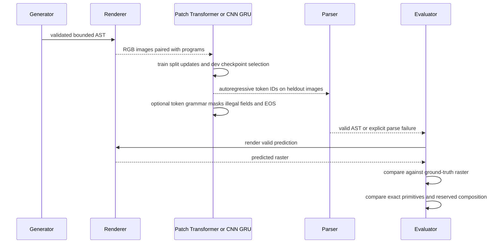

# From scene pixels to executable geometry

## Input and trust boundary

The language parser is the only execution boundary: it accepts an allowlist of primitive names/colors and canonical integer coordinates. Programs are at most 4096 characters, contain at most four shapes, and stay inside a fixed 32x32 canvas. Rendering a validated AST is a bounded local calculation. Programs cannot execute arbitrary Python, browser scripts, shell commands, or remote calls. SVG attributes come exclusively from validated enums and numbers.

Images use one strict generated PPM format; other image encodings and large files fail visibly. Dataset manifests have a 100 MB size limit, verified program hashes, split checks, and image paths restricted to the dataset directory. Checkpoints are loaded with torch's `weights_only=True` mode and matched against the fixed vocabulary and bounded architecture configuration. Treat external checkpoints and datasets as untrusted inputs; this repository does not automatically download either.

## Dataset and evaluation boundary

Scene generation is seeded and deduplicated by both canonical program hash and rendered image hash across all splits. Training lacks both green rectangles and blue ellipses. The designated heldout primitive is drawn last and must visibly change at least half its own foreground area, preventing a hidden composition from masquerading as a visible heldout challenge. Development may use green rectangles to choose a checkpoint; test blue ellipses remain unseen during that selection. The generator supplies labels, but the learned encoder receives only RGB tensors at inference. Expected programs are available only to evaluation. Manifest loading verifies that each image equals its program's rendered raster.

`evaluate` is a codec/renderer test: it parses the known ground-truth program and checks raster equivalence. It reports its oracle provenance explicitly. `evaluate-model` runs a saved trained model on image inputs and separately reports parse validity and reconstruction metrics. Invalid programs have zero reconstruction credit, and raw predictions remain in the report.

## Resource and failure contract

Dataset sizes, epochs, batch size, hidden width, image dimensions, and generation length are bounded. Optional torch imports occur only inside training/inference entry points, so offline correctness tests run without ML dependencies. Missing dependencies and invalid inputs raise visible errors; there is no synthetic fallback presented as model output.

Manifests require exact typed fields, reject duplicate JSON keys, and bound each line. Absolute/parent-traversal paths and escaping symlinks are rejected on both reads and writes. Reserved compositions must remain at least half visible when a manifest is loaded, not merely when it is generated. Dataset deduplication has a finite attempt budget.

`decoding.py` implements the optional token grammar. Its state includes field phase, primitive count, x and y coordinates, and EOS completion. Width/height masks respect remaining canvas space. It never receives ground-truth labels. Autoregressive evaluation retains raw IDs, requires EOS, and records invalid streams as failures. Exact primitive metrics use multisets, so order changes do not create extraction errors and duplicate predicted objects do not gain extra credit. Raster metrics still capture occlusion/order differences.

Checkpoint selection uses development loss; test accuracy is not used for training. Training determinism is seeded, but identical GPU results are not guaranteed across different hardware/library versions. Preserve software versions and hardware configuration in published experiment reports.
## Neural implementations

The spatial patch Transformer and CNN/GRU comparator share the optimization and search interfaces. The Transformer uses a visual cross-attention program decoder; both paths use bounded likelihood beam search and atomic latest/best checkpointing. [attention-and-search.md](attention-and-search.md) specifies causal masks, probability semantics, the restart protocol, and complexity. [spatial-attention-results.md](spatial-attention-results.md) records the short paired experiment and its incorrect generations.
